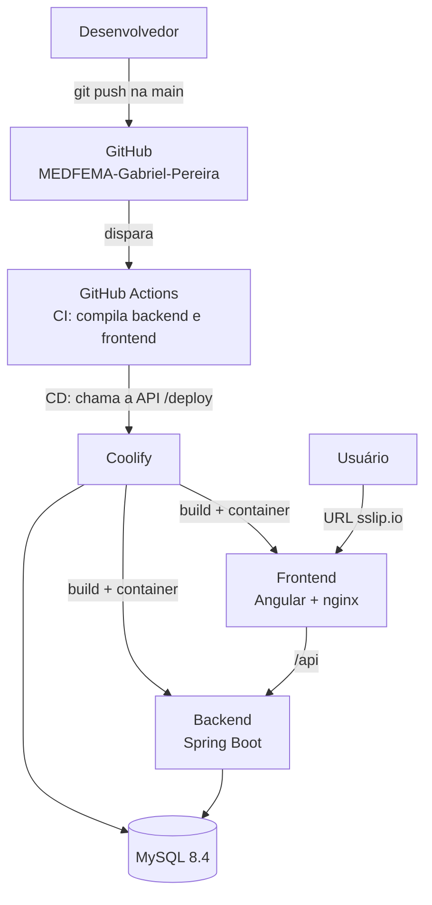
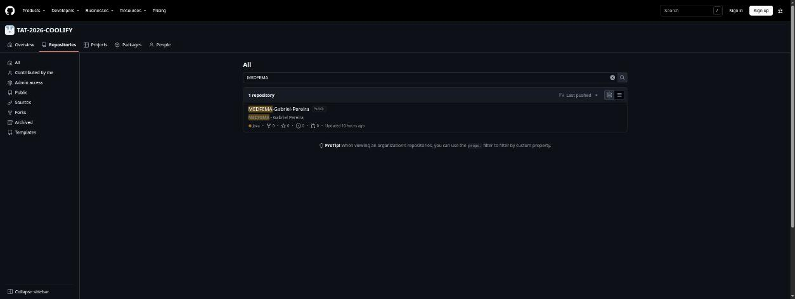
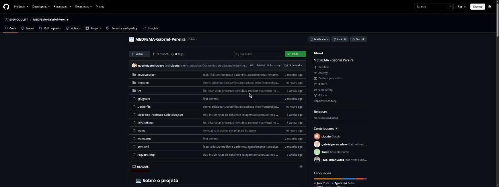
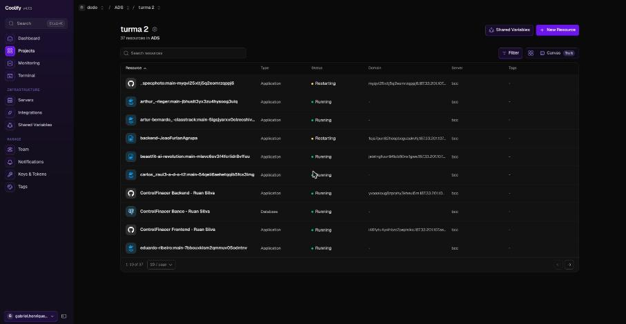
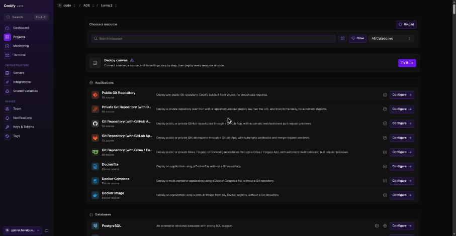
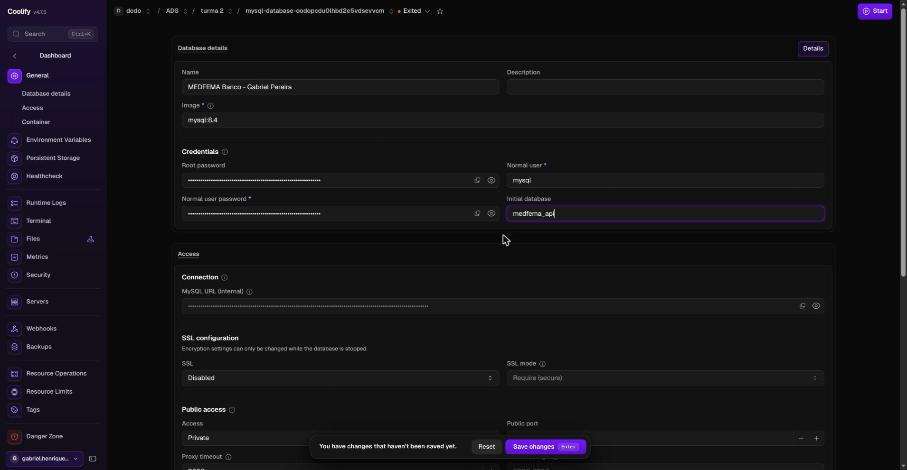
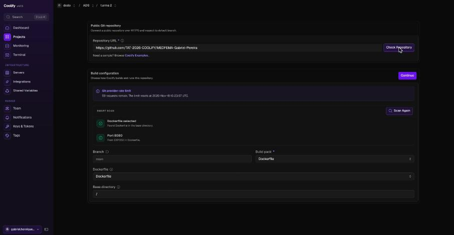

<p align="center"></p>

# Manual de CI/CD: entrega do MEDFEMA no Coolify

| | |
|---|---|
| **Aluno** | Gabriel Henrique Pereira (RA 2411550620) |
| **Aplicação** | MEDFEMA (agendamento de consultas médicas) |
| **Repositório** | https://github.com/TAT-2026-COOLIFY/MEDFEMA-Gabriel-Pereira |
| **Coolify** | https://computacao.fema.edu.br (projeto **ADS**, ambiente **turma 2**) |

## Sumário

- [Visão geral](#visão-geral)
- [1. Criação do projeto no GitHub](#1-criação-do-projeto-no-github)
- [2. GitHub Actions: ligação entre GitHub e Coolify](#2-github-actions-ligação-entre-github-e-coolify)
- [3. Criação do projeto no Coolify](#3-criação-do-projeto-no-coolify)
- [4. Execução da aplicação na URL](#4-execução-da-aplicação-na-url)
- [5. Problemas comuns](#5-problemas-comuns)

---

## Visão geral

O MEDFEMA tem três partes, e cada uma vira um recurso separado no Coolify:

| Parte | Tecnologia | Como roda no Coolify | Porta |
|---|---|---|---|
| Banco de dados | MySQL 8.4 + Flyway (migrations) | Recurso de banco de dados do Coolify | 3306 (só rede interna) |
| Backend (API) | Spring Boot 3, Java 17 | Imagem Docker gerada pelo `Dockerfile` da raiz | 8080 |
| Frontend | Angular 22 servido por nginx | Imagem Docker gerada por `frontend/Dockerfile` | 80 |

Fluxo completo de entrega (CI/CD):



Em palavras:

1. O desenvolvedor faz `git push` na branch `main`.
2. O **GitHub Actions** compila o backend e o frontend. Esse é o **CI** (integração contínua): se algo não compilar, o processo para aqui e nada quebrado vai para o servidor.
3. Se o build passou, o Actions chama a API do Coolify pedindo um novo deploy. Esse é o **CD** (entrega contínua).
4. O **Coolify** baixa a `main`, gera as imagens Docker e troca os containers antigos pelos novos.
5. O usuário acessa a URL do frontend. O nginx do frontend repassa as chamadas `/api` para o backend, que grava no MySQL.

---

## 1. Criação do projeto no GitHub

### 1.1 Organização da turma

O professor liberou a organização **TAT-2026-COOLIFY** no GitHub. Cada aluno cria nela o repositório do seu projeto. O nome segue o padrão da turma, `PROJETO-Nome-Sobrenome`.



### 1.2 Criação do repositório

O código já existia num repositório de trabalho (`Tursz/MEDFEMA`). Para a entrega, foi criado um repositório novo na organização, e o código foi enviado para ele por um *remote* separado. Assim o repositório original fica intacto.

Comandos usados (Ubuntu, com o [GitHub CLI](https://cli.github.com/) logado):

```bash
# 1. Cria o repositório público dentro da organização
gh repo create TAT-2026-COOLIFY/MEDFEMA-Gabriel-Pereira --public --description "MEDFEMA - Gabriel Pereira"

# 2. Liga o projeto local ao repositório novo, com o nome de remote "coolify"
git remote add coolify https://github.com/TAT-2026-COOLIFY/MEDFEMA-Gabriel-Pereira.git

# 3. Envia a branch local deploy/coolify como main do repositório novo
git push coolify deploy/coolify:main
```

**Por que público?** No Coolify, a opção *Public Git Repository* baixa o código sem precisar de senha, chave ou GitHub App. É a forma mais simples para um projeto acadêmico.

**Alternativa pelo site:** GitHub → **New repository** → *Owner*: `TAT-2026-COOLIFY` → *Repository name*: `MEDFEMA-Gabriel-Pereira` → **Public** → **Create repository**. Depois disso, rodar só os passos 2 e 3 acima.

Resultado, com o repositório criado e o código enviado:



### 1.3 Arquivos que preparam o projeto para o Coolify

O Coolify roda tudo em containers Docker. Por isso foram adicionados três arquivos ao projeto.

#### `Dockerfile` (raiz): backend

```dockerfile
# Etapa 1: compila o projeto e gera o .jar
FROM maven:3.9-eclipse-temurin-17 AS build
WORKDIR /app
COPY pom.xml .
COPY src ./src
# Testes pulados: o ApiApplicationTests sobe o contexto inteiro e precisa de um MySQL rodando
RUN mvn -B -DskipTests package

# Etapa 2: imagem final, só com o Java e o .jar (bem menor)
FROM eclipse-temurin:17-jre
WORKDIR /app
COPY --from=build /app/target/*.jar app.jar
EXPOSE 8080
ENTRYPOINT ["java", "-jar", "app.jar"]
```

- O build tem **duas etapas** (*multi-stage*). A primeira tem o Maven e compila o projeto. A segunda leva só o Java e o `.jar`, o que deixa a imagem final bem menor.
- Os testes são pulados (`-DskipTests`) porque o teste `ApiApplicationTests` precisa de um banco rodando, que não existe durante o build.
- A conexão com o banco **não** fica no código. O Spring Boot dá prioridade às variáveis de ambiente `SPRING_DATASOURCE_URL`, `SPRING_DATASOURCE_USERNAME` e `SPRING_DATASOURCE_PASSWORD` sobre o `application.properties`, e essas variáveis são configuradas no Coolify (seção 3.4).

#### `frontend/Dockerfile`: frontend

```dockerfile
# Etapa 1: compila o Angular
FROM node:24-alpine AS build
WORKDIR /app
COPY package.json package-lock.json ./
RUN npm ci
COPY . .
RUN npx ng build

# Etapa 2: nginx entrega os arquivos e repassa /api para o backend
FROM nginx:1.27-alpine
COPY nginx.conf /etc/nginx/templates/default.conf.template
COPY --from=build /app/dist/frontend/browser /usr/share/nginx/html
EXPOSE 80
```

- A primeira etapa compila o Angular com Node 24. O Angular 22 exige Node 22.22 ou superior.
- A segunda etapa usa o **nginx** para entregar os arquivos estáticos (`index.html`, JS, CSS).

#### `frontend/nginx.conf`: proxy para a API

```nginx
server {
    listen 80;
    root /usr/share/nginx/html;
    index index.html;

    resolver 127.0.0.11 valid=10s ipv6=off;

    # /api/medicos -> BACKEND_URL/medicos
    location /api/ {
        set $backend ${BACKEND_URL};
        rewrite ^/api/(.*)$ /$1 break;
        proxy_pass $backend;
    }

    # Rotas do Angular: caminhos que não são arquivos voltam para o index.html
    location / {
        try_files $uri $uri/ /index.html;
    }
}
```

- **Por que esse arquivo é necessário:** o frontend chama a API em `/api/medicos`, `/api/pacientes` etc. Em desenvolvimento, quem repassa essas chamadas para o backend é o `proxy.conf.json` do `ng serve`, que **não existe em produção**. Em produção, o nginx faz esse papel.
- `${BACKEND_URL}` é trocado pelo endereço do backend quando o container inicia. Esse valor é configurado no Coolify (seção 3.5).
- O `try_files` faz as rotas do Angular, como `/medicos`, funcionarem quando o usuário dá F5 ou abre o link direto.

---

## 2. GitHub Actions: ligação entre GitHub e Coolify

### 2.1 Como funciona

O repositório é público e não usa GitHub App, então o Coolify **não fica sabendo sozinho** quando há um push novo. Quem avisa é o GitHub Actions. A cada push na `main`, ele:

1. **CI (job `build`):** compila o backend com Maven e o frontend com Angular. Se falhar, o deploy não acontece.
2. **CD (job `deploy`):** chama a API do Coolify (`/api/v1/deploy`). O Coolify então baixa a `main`, gera as imagens novas e reinicia os containers.

### 2.2 O arquivo `.github/workflows/deploy.yml`

```yaml
name: CI/CD - Deploy no Coolify

on:
  push:
    branches: [main]
  workflow_dispatch:

env:
  COOLIFY_URL: https://computacao.fema.edu.br

jobs:
  build:
    name: Build (backend + frontend)
    runs-on: ubuntu-latest
    steps:
      - name: Baixar o código
        uses: actions/checkout@v4

      - name: Instalar Java 17
        uses: actions/setup-java@v4
        with:
          distribution: temurin
          java-version: '17'
          cache: maven

      - name: Compilar backend (Spring Boot)
        run: mvn -B -DskipTests package

      - name: Instalar Node 24
        uses: actions/setup-node@v4
        with:
          node-version: '24'
          cache: npm
          cache-dependency-path: frontend/package-lock.json

      - name: Compilar frontend (Angular)
        working-directory: frontend
        run: |
          npm ci
          npx ng build

  deploy:
    name: Deploy no Coolify
    needs: build
    runs-on: ubuntu-latest
    steps:
      - name: Disparar deploy pela API do Coolify
        env:
          COOLIFY_TOKEN: ${{ secrets.COOLIFY_TOKEN }}
          COOLIFY_APP_UUIDS: ${{ vars.COOLIFY_APP_UUIDS }}
        run: |
          curl --fail-with-body -sS \
            -H "Authorization: Bearer $COOLIFY_TOKEN" \
            "$COOLIFY_URL/api/v1/deploy?uuid=$COOLIFY_APP_UUIDS&force=false"
```

| Trecho | O que faz |
|---|---|
| `on: push: branches: [main]` | Roda o workflow a cada push na `main`. |
| `workflow_dispatch` | Permite rodar à mão pelo botão **Run workflow** na aba *Actions*. |
| `needs: build` | O job `deploy` só começa se o `build` terminar com sucesso. |
| `secrets.COOLIFY_TOKEN` | Token da API do Coolify. Fica guardado como **segredo** e nunca aparece no código nem nos logs. |
| `vars.COOLIFY_APP_UUIDS` | Identificadores (UUIDs) do backend e do frontend no Coolify, separados por vírgula. |
| `curl ... /api/v1/deploy?uuid=...` | Pede ao Coolify o deploy das aplicações informadas. O `--fail-with-body` faz o job falhar, e mostrar o erro, se o Coolify recusar. |

### 2.3 Gerar o token da API no Coolify

1. No Coolify, menu lateral → **Keys & Tokens** → **API tokens**.
2. Criar um token com um nome (ex.: `github-actions-medfema`) e a permissão **deploy**.
3. Copiar o token. Ele aparece **uma única vez**.

Observação: a API precisa estar habilitada pelo administrador do Coolify. Se a opção não aparecer, peça ao professor.

### 2.4 Cadastrar o segredo e a variável no GitHub

No repositório: **Settings** → **Secrets and variables** → **Actions**.

| Aba | Nome | Valor |
|---|---|---|
| *Secrets* → **New repository secret** | `COOLIFY_TOKEN` | o token copiado no passo 2.3 |
| *Variables* → **New repository variable** | `COOLIFY_APP_UUIDS` | `<uuid-do-backend>,<uuid-do-frontend>` |

O UUID de cada aplicação aparece na URL dela no Coolify: `.../application/<uuid>`.

### 2.5 Primeira execução do workflow

Depois de cadastrar o segredo e a variável, basta enviar o workflow para a `main`:

```bash
git add .github/workflows/deploy.yml
git commit -m "ci: adicionar workflow de deploy no Coolify"
git push coolify deploy/coolify:main
```

Na aba **Actions** do repositório aparece a execução com os dois jobs, `build` e `deploy`.

---

## 3. Criação do projeto no Coolify

### 3.1 Acessar o ambiente da turma

Dentro do Coolify, abrir **Projects** → **ADS** → ambiente **turma 2**. A tela lista os recursos de todos os alunos da turma.



### 3.2 Novo recurso

O botão **+ New Resource** abre a lista de tipos de recurso. Para o MEDFEMA são usados dois tipos: **Public Git Repository** (backend e frontend) e **MySQL** (banco).



### 3.3 Banco de dados MySQL

1. Em **New Resource**, seção *Databases*, clicar em **Configure** ao lado de **MySQL**.
2. Preencher:

   | Campo | Valor | Por quê |
   |---|---|---|
   | Name | `MEDFEMA Banco - Gabriel Pereira` | Identificar o recurso na lista da turma |
   | Image | `mysql:8.4` | Versão LTS do MySQL 8, compatível com o Flyway e o driver do projeto. O padrão do Coolify é a 9.x |
   | Normal user | `mysql` (padrão) | Usuário que o backend vai usar |
   | Initial database | `medfema_api` | Mesmo nome de banco usado pelo projeto |
   | Senhas | geradas pelo Coolify | Copiar com o botão ao lado do campo quando precisar |

3. Clicar em **Save changes** e depois em **Start**.



O Coolify mostra a **MySQL URL (internal)** no formato `mysql://mysql:<senha>@<uuid-do-banco>:3306/medfema_api`. O `<uuid-do-banco>` é o nome do container na rede interna do Coolify. Neste projeto ele é `oodopcdu0lhbd2e5vdsevvcm`, e é esse nome que o backend usa para encontrar o banco.

### 3.4 Backend (Spring Boot)

1. **New Resource** → **Public Git Repository**.
2. *Repository URL*: `https://github.com/TAT-2026-COOLIFY/MEDFEMA-Gabriel-Pereira` → **Check repository**.
3. O *Smart scan* do Coolify encontra o `Dockerfile` na raiz e a porta **8080** (do `EXPOSE`). Conferir:
   - Branch: `main`
   - Build pack: `Dockerfile`
   - Base directory: `/`
4. Clicar em **Continue**.



5. Na tela da aplicação:
   - **Name:** `MEDFEMA Backend - Gabriel Pereira`
   - **Domains:** gerar um domínio (botão *Generate Domain*). O Coolify cria um endereço `http://<id>.187.33.201.107.sslip.io`.
6. Em **Environment Variables**, cadastrar:

   | Variável | Valor |
   |---|---|
   | `SPRING_DATASOURCE_URL` | `jdbc:mysql://oodopcdu0lhbd2e5vdsevvcm:3306/medfema_api?allowPublicKeyRetrieval=true&useSSL=false` |
   | `SPRING_DATASOURCE_USERNAME` | `mysql` |
   | `SPRING_DATASOURCE_PASSWORD` | senha do usuário `mysql`, copiada da tela do banco (3.3) |

   - `allowPublicKeyRetrieval=true&useSSL=false` é necessário porque o MySQL 8 usa o método de login `caching_sha2_password` e a conexão interna não usa SSL.
   - Na primeira subida, o **Flyway** cria as tabelas sozinho, rodando as migrations `V1` a `V6` de `src/main/resources/db/migration`.

7. Clicar em **Deploy**.

### 3.5 Frontend (Angular + nginx)

1. **New Resource** → **Public Git Repository**, com o mesmo repositório.
2. Depois do *Check repository*, ajustar:
   - **Base directory:** `/frontend`
   - **Build pack:** `Dockerfile`
   - **Port:** `80`
3. **Continue** → **Name:** `MEDFEMA Frontend - Gabriel Pereira` → gerar o domínio.
4. Em **Environment Variables**:

   | Variável | Valor |
   |---|---|
   | `BACKEND_URL` | domínio do backend gerado no passo 3.4, **sem barra no final** (ex.: `http://<id>.187.33.201.107.sslip.io`) |

5. Clicar em **Deploy**.

---

## 4. Execução da aplicação na URL

### 4.1 Acompanhar o deploy

Cada deploy, seja disparado pelo GitHub Actions ou pelo botão **Deploy**, aparece na aba **Deployments** da aplicação, com o log completo: clone do repositório, build da imagem Docker e início do container.

### 4.2 Como a URL chega até a aplicação

1. O domínio gerado (`<id>.187.33.201.107.sslip.io`) usa o serviço **sslip.io**, que responde com o IP que está escrito no próprio nome (`187.33.201.107`, o servidor do Coolify). Por isso não é preciso registrar um domínio.
2. No servidor, o **proxy do Coolify (Traefik)** recebe a requisição e, pelo nome do domínio, encaminha para o container certo.
3. O container do **frontend** (nginx) devolve a tela do Angular.
4. Quando a tela chama `/api/...`, o nginx repassa a chamada para o **backend** (`BACKEND_URL`), que consulta o **MySQL** pela rede interna.

### 4.3 Testar o sistema

Abrir a URL do frontend no navegador e conferir:

1. Cadastrar um médico.
2. Cadastrar um paciente.
3. Agendar uma consulta e depois cancelar.

### 4.4 Ciclo de atualização (CI/CD na prática)

| Passo | Quem faz | O que acontece |
|---|---|---|
| 1 | Desenvolvedor | Altera o código e faz `git commit` + `git push` na `main` |
| 2 | GitHub Actions | Job `build`: compila backend e frontend |
| 3 | GitHub Actions | Job `deploy`: chama a API do Coolify |
| 4 | Coolify | Baixa a `main`, gera as imagens novas e troca os containers |
| 5 | Usuário | Atualiza a página e já vê a versão nova |

---

## 5. Problemas comuns

| Sintoma | Causa provável | Solução |
|---|---|---|
| Build do backend falha nos testes | O teste `ApiApplicationTests` tenta conectar no MySQL | Manter o `-DskipTests` no Dockerfile e no workflow |
| Backend reinicia com `Communications link failure` | `SPRING_DATASOURCE_URL` errada ou banco parado | Conferir o UUID do banco na URL e se o MySQL está *Running* |
| Backend com `Access denied for user` | Senha errada em `SPRING_DATASOURCE_PASSWORD` | Copiar de novo a senha na tela do banco |
| Tela abre, mas as listas dão erro 502 | `BACKEND_URL` errada, com barra no final, ou backend parado | Corrigir a variável no frontend e fazer *Redeploy* |
| Job `deploy` do Actions falha com 401 | Token inválido ou sem permissão de deploy | Gerar outro token (2.3) e atualizar o segredo `COOLIFY_TOKEN` |
| Painel do Coolify não abre ou deploy trava | Servidor da turma sobrecarregado | Esperar e tentar fora do horário de pico |

